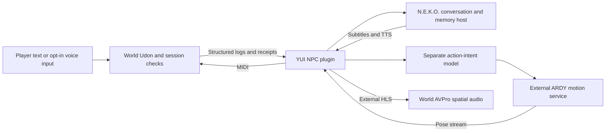

# VRC-NEKO: an AI NPC that lives in a VRChat world

[中文说明](README.zh-CN.md)

VRC-NEKO connects YUI, the AI character of [Project N.E.K.O.](https://github.com/Project-N-E-K-O/N.E.K.O), to a VRChat world. It lets her talk with players, move around the world and express herself through body motion, guided by the semantic and navigation information the world author provides. VRC-NEKO is an official affiliated project of Project N.E.K.O. It is published from my personal GitHub account, [keepwin-Neil](https://github.com/keepwin-Neil), and I maintain it.

This repository is a public source snapshot of local version **0.5.19** (prepared on 26 October 2026). It contains the plugin, the protocol, the control panel, the Unity/Udon C# scripts and the automated tests. It is a prototype that is still being integrated and tested. It is **not** a finished world, a ready-to-import character package, or a product validated with multiple players.

## How it works



- **The world side** handles permissions, sessions, navigation, skeleton playback, and reports whether each action actually completed or failed.
- **The desktop side** handles events, behavior orchestration, continuous motion streaming and failure recovery.
- **Motion generation** uses the [official NVIDIA ARDY implementation](https://github.com/nv-tlabs/ardy). This repository contains only the adapter that connects to it. It does not redistribute ARDY models, weights or upstream code.

The character currently understands her surroundings through structured semantic and navigation data. AI vision is **not** yet working end to end: the eye-camera and follow-camera code does not mean the AI can see the world.

## Reporting what actually happened

A design rule runs through the project: **a generated action is not the same as an executed action.** The world sends back a receipt saying whether each action really completed or failed, and the plugin treats "the model produced a motion" and "the character actually did it" as two different results. The known issues below are listed openly for the same reason.

## History and my role

- **Versions up to 0.5.14 (30 August – 14 September 2026)** were co-developed with [ggg233m](https://github.com/ggg233m) and published in his [YUI NPC Controller](https://github.com/ggg233m/n.e.k.o_plugin_vrc_npc_controller) repository. That repository includes code I wrote, and contributions from this period cannot be separated file by file.
- **From version 0.5.15 onwards**, upgrades, optimization and maintenance have been mainly my work. This repository is the version I prepared and maintain independently.

My role covers the requirements and scope of the world NPC, feature decisions and trade-offs, integration with the Unity world, local deployment and debugging, verification of behavior, and decisions on what to publish. The integration work in this version includes:

- connecting N.E.K.O. to world events;
- adapting the separate action-intent model and the continuous motion service;
- subtitles and player input;
- spatial voice output and opt-in player speech leases;
- the control panel;
- session recovery;
- regression testing.

Much of the implementation was written with AI coding assistants (see below). This list describes the scope of the integration work. It does not mean that every line in these folders was written by me from scratch.

## Current status

Status as of 26 October 2026. Preparing this public snapshot did not involve running real models, paid APIs, audio playback or VRChat Local Test.

| Area | Status and limits of verification |
|---|---|
| MIDI, log receipts, sessions and control | Implemented, with automated tests and earlier client records; a full live regression of the latest version is not yet done |
| ARDY continuous motion | Real generation, transport and earlier in-world execution recorded; path-constraint failures, motion quality, foot sliding and jitter not fully solved |
| Subtitles, text input, companionship and proactive conversation | Code and tests exist; VR readability, real keyboard/mouse/VR controls and multiplayer experience still to be tested |
| Spatial voice output | TTS → HLS → AVPro pipeline implemented; HTTP 530 and `PlayerError` seen earlier; no full multiplayer or spatial-audio test yet |
| Player microphone input | Implemented in 0.5.19 with local build and automated checks; the matching world is not uploaded and real multiplayer microphone use is untested |
| Vision, devices and platforms | No verified AI vision loop; support for Quest, PCVR, macOS and multi-machine setups has not been validated |

## Known issues

- `stream_path_constraint` has caused the backend to keep generating while execution in the world failed. The exact trigger has not been found. Successful generation does not mean successful execution.
- Latency of the action-intent API varies. Delays of several seconds, including an abnormal delay of about 10.7 seconds, have been recorded, so sub-second responses are not promised. The current prompt redirects backflip requests into refusal or hesitant motions; this is not evidence that ARDY cannot generate a backflip.
- The YUI plugin has crashed and recovered after a restart; the root cause is unknown. World/client freezes, native UnityPlayer crashes and system blue screens have also been recorded. Whether these are related has not been established.
- Unity asynchronous builds once hit a PlayerLoop recursion error. Later successful builds do not prove the root cause is gone for good.
- Player voice input captures the mixed audio of the VRChat process and uses an explicit speaking lease with offline Windows recognition. It is not speaker verification and cannot reliably separate several players or model audio. Cleanup of temporary audio after forced termination still needs checking.
- Stability over 30 minutes, ownership handover, late joiners, multiplayer voice and synchronization have not been fully tested. Memory-write and motion-context delays, earlier `action_busy` events and host-routing noise also lack a complete latest-version closure check.
- The semantic map, NavMesh, characters, fonts and Inspector references are not included. Some Editor tools still expect the old asset names and paths.
- The motion-service adapter includes local backend extensions, so it is **not guaranteed** to work with an unmodified official ARDY. See [integrations/motion_service/README.md](integrations/motion_service/README.md) (in Chinese).

## Testing

Offline checks on this public snapshot: **567 Python tests passed, 5 skipped, 357 subtests passed; 7 Node tests passed.** The 5 skipped tests need Windows native helpers that are not distributed. These results do not replace live multiplayer testing. Details are in [Docs/VALIDATION.md](Docs/VALIDATION.md) (in Chinese).

## Repository layout

| Path | Contents |
|---|---|
| `runtime/`, `__init__.py` | Plugin runtime: sessions, intent, behavior execution, motion streaming and voice coordination |
| `ui/` | N.E.K.O. plugin control panel |
| `unity/` | World-side C# scripts and their `.meta` files; not a full Unity project |
| `Docs/Protocols/` | YUI protocol, constants and synthetic test vectors |
| `integrations/motion_service/` | Local motion service and adapter for the external model |
| `host/` | Frontend voice bridge, source of the Windows recognition and process-audio helpers, dependency list |
| `tests/` | Regression tests for the runtime, protocol and source contracts |
| `scripts/check_public_release.py` | Release check that scans staged content and all reachable history |

## Getting started

This snapshot provides development source code, not a verified one-click installer. The plugin requires **Python 3.11**.

```bash
python -m pip install -e ".[dev]"
python run_tests.py -q
node --test host/yui-voice-relay.test.cjs
```

To run the plugin inside the host, install [Project N.E.K.O.](https://github.com/Project-N-E-K-O/N.E.K.O) separately and deploy this folder as `plugin/plugins/yui_npc_controller/`. Voice output, voice input and ARDY are all off by default in `config.example.toml`. Never put keys into tracked files. The motion service listens only on the local loopback address and must not be exposed to the internet. Full setup notes, including Unity and voice dependencies, are in the [Chinese README](README.zh-CN.md).

## What is not included

Paid or third-party assets, worlds, character models, scenes, fonts, animations, materials, weights, datasets, `.vrcw`/`.vrca` files, installers, raw logs, chat memory, backups and the old Git history. The public copy starts from a new, clean history so that none of this is carried over. For this reason, the commit history of this repository does not show who wrote which code.

## Public release checks

The source allowlist in `.gitignore` excludes private data and assets. Before publishing a change, scan the exact staged content and reachable history:

```bash
git add .
python scripts/check_public_release.py --staged
python scripts/check_public_release.py --all-history
```

Before staging, `python scripts/check_public_release.py --working-tree` checks files admitted by the public-source policy. Static checks cannot detect every possible secret format; review the changes and follow [SECURITY.md](SECURITY.md) as well.

## Demo

No live demo video has yet been cleared for privacy, asset-display rights and accuracy. An upstream ARDY demo or simulated animation will not be presented as this project's live results. The [Chinese README](README.zh-CN.md#演示视频) describes the planned recording scope.

## AI-assisted development

AI coding assistants, including Codex, were used for implementation, refactoring, testing, debugging, documentation and preparing this release. I set the goals, chose between approaches, provided the environment and feedback, and verified the behavior. AI-generated code and explanations can be wrong. Automated tests, successful builds and AI judgments do not replace live, multiplayer and long-duration testing in VRChat.

## Acknowledgements

- [ggg233m](https://github.com/ggg233m), co-developer of the early versions, for his support and contributions; see his [VRChat body plugin](https://github.com/ggg233m/n.e.k.o_plugin_vrc_body) and [YUI NPC Controller](https://github.com/ggg233m/n.e.k.o_plugin_vrc_npc_controller).
- The [Project N.E.K.O. team](https://github.com/Project-N-E-K-O) and the [N.E.K.O. project](https://github.com/Project-N-E-K-O/N.E.K.O), for supporting this project and building the ecosystem.
- [wehos](https://github.com/wehos), for contributions to N.E.K.O. and its ecosystem.
- The [NVIDIA ARDY authors and team](https://github.com/nv-tlabs/ardy), for the motion-generation research and official implementation.
- VRChat, UdonSharp, Unity, and the authors of the MIDI, voice and other tools used here.

## License

Copyright attribution and licensing follow Project N.E.K.O.'s official release arrangements. External dependencies keep their own copyright and license notices, including the files in `host/licenses/`. The source code in this repository is not yet released under a single MIT or Apache license. See [THIRD_PARTY_NOTICES.md](THIRD_PARTY_NOTICES.md) (in Chinese).
