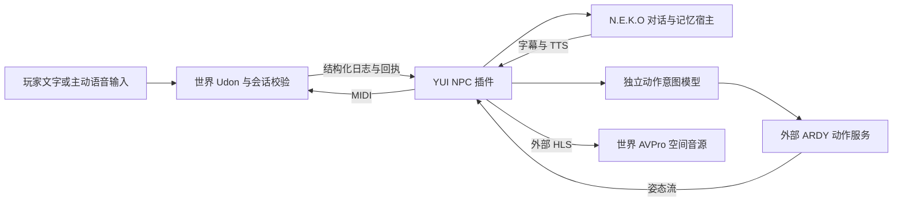

# VRC-NEKO · YUI 世界 NPC

基于 Project N.E.K.O 的非官方 VRChat 世界 NPC 集成原型。目标是让 AI 角色在世界里交流、移动、表达身体动作，并根据地图作者提供的语义和导航约束行动。

这是 **0.5.19 本地工程的公开源码整理版**（整理日期：2026-10-26），包含插件、协议、控制面板、Unity/Udon C# 源码及自动测试。它处于持续联调阶段，**不是完整地图、可直接导入的角色包或已经完成多人验收的成品**。

## 项目简介



世界端负责权限、会话、导航、骨骼播放和实际完成/失败回执；桌面端负责事件处理、行为编排、连续动作传输和故障恢复。当前环境理解依赖结构化语义与导航信息，**没有完成 AI 视觉理解闭环**。EyeCam 和跟拍相机代码不等于 AI 已能看见世界。

动作生成模型使用 [NVIDIA ARDY 官方实现](https://github.com/nv-tlabs/ardy)。本仓库只保留连接该后端的服务适配层，**不重新发布 ARDY 模型、权重、上游完整代码或修改后的上游覆盖文件**。模型、文本编码器及其授权由使用者从原始发布方获取。

## 我本人负责的部分与贡献边界

本仓库维护者是 [keepwin-Neil](https://github.com/keepwin-Neil)。本人负责世界 NPC 方案的需求定义、功能取舍、组织 Unity 世界整合与本机部署联调、提供使用反馈及决定公开范围；具体实现和配置过程使用了大量 AI 辅助，也建立在上游已有插件和控制协议的基础上。

本地工程中的工作范围包括：N.E.K.O 与世界事件的接入、独立动作意图与连续动作服务适配、字幕与玩家输入、空间语音及显式发言租约、控制面板、会话恢复和回归验证。上述范围是集成工作的说明，**不代表这些目录中的每行代码均由本人手写或从零原创**。

上游 YUI/VRChat 插件、协议与骨骼控制提供了重要基础；N.E.K.O 的主对话、记忆、TTS 和 SDK，以及 NVIDIA 的基础动作模型，不属于本人独立研发成果。公开副本采用新的干净历史，旧工程与上游之间尚未完成逐文件贡献溯源，不能用本仓库首次提交的作者统计判断原创归属。详见 [来源与权利说明](THIRD_PARTY_NOTICES.md)。

## AI 辅助开发说明

项目在代码实现、重构、测试、调试、文档和本次公开整理中使用了 AI 编程助手，包括 Codex。维护者提供目标、环境与反馈，并负责选择方案、验证行为及维护。AI 生成的代码与解释可能存在错误；自动测试、构建成功和 AI 的判断均不能替代 VRChat 实机、多人与长时间验收。

## 当前状态与已知问题

以下状态结合本地源码和截至 2026-10-26 的交接记录；本次公开整理没有启动真实模型、调用付费 API、播放音频或执行 VRChat Local Test。

| 部分 | 当前状态与验证边界 |
|---|---|
| MIDI、日志回执、会话与控制权 | 已实现并有自动测试和历史客户端记录；最新版本完整实机回归仍未完成 |
| ARDY 连续动作 | 有真实模型生成、传输和历史世界执行证据；路径约束失败、动作质量、脚滑与抖动未完整解决 |
| 字幕、文字输入、陪伴与主动搭话 | 代码与测试存在；新版 VR 双眼观感、阅读体验、真实 WASD/鼠标/VR 操作和多人体验待验收 |
| 空间语音输出 | TTS→HLS→AVPro 链路已实现；历史出现 HTTP 530 和 `PlayerError`，尚无完整的多人播放及空间听感验收 |
| 玩家麦克风输入 | 0.5.19 已实现并有本地构建/自动验证记录；对应新世界未上传，真实多人麦克风未验收 |
| 视觉、跨设备与平台 | 尚无已验证 AI 视觉闭环；Quest、PCVR、macOS 与跨机器部署不能视为已支持 |

仍需明确保留的故障和限制：

- `stream_path_constraint` 曾导致后端持续生成而世界执行失败，具体触发分支尚未定位；生成成功不代表世界执行成功。
- 动作意图 API 延迟存在波动，历史记录有数秒及约 10.7 秒的异常延迟，不承诺一秒内动作响应。当前提示词仍会将后空翻请求改为拒绝或为难动作，这不是 ARDY 无法生成该动作的证明。
- YUI 插件曾出现 `crashed` 并在重启后恢复，根因未解决。世界/客户端无响应、UnityPlayer 原生崩溃及系统蓝屏也有历史记录；彼此是否相关尚未证实，不能直接归责于语音、地图或显卡驱动。
- Unity 异步构建曾出现 PlayerLoop 递归错误；后续构建成功不能证明根因已永久消除。
- 玩家语音输入捕获的是 VRChat 进程的混音，采用主动发言租约与 Windows 离线识别；不是声纹认证，不能可靠分离多人或模型音效。强制终止后的临时音频残留仍需检查。
- 30 分钟以上稳定性、ownership 交接、晚加入、多人语音与同步尚无完整验收。记忆写盘和动作上下文延迟、历史 `action_busy` 与宿主路由噪声也没有最新逐项关闭证据。
- 语义地图、NavMesh、角色、字体及 Inspector 引用没有打包。部分 Editor 工具仍约定旧的资产名称和相对路径，需要使用者准备获授权资源并自行适配。
- 当前动作服务适配器包含本地后端扩展接口，**不能保证与未修改的官方 ARDY 直接兼容**；图重放、NF4 服务与完整安装器不在此公开版内。详见 [后端接入边界](integrations/motion_service/README.md)。

本次公开副本离线验证为 **567 项 Python 测试通过、5 项跳过、357 项子测试通过，7 项 Node 测试通过**。历史测试与本次结果的边界记录在 [验证说明](Docs/VALIDATION.md)，这些结果不等于真实多人或原生辅助程序验收通过。

## 仓库内容

| 路径 | 内容 |
|---|---|
| `runtime/`、`__init__.py` | 插件运行时、会话、意图、行为执行、动作流及语音协调 |
| `ui/` | N.E.K.O 插件控制面板源码 |
| `unity/` | 世界端 C# 和相应脚本 `.meta`；不含完整 Unity 工程 |
| `Docs/Protocols/` | YUI 协议、常量与合成测试向量 |
| `integrations/motion_service/` | 本机动作服务与外部模型适配器 |
| `host/` | 前端语音桥接、Windows 识别/进程音频辅助程序源码与依赖清单 |
| `tests/` | 运行时、协议和源码契约回归测试 |
| `scripts/check_public_release.py` | 精确扫描暂存内容与全部可达历史的发布检查 |

## 开发与安装边界

建议先阅读 [Unity 接入说明](unity/README.md) 和 [后端说明](integrations/motion_service/README.md)。此公开版提供开发源码，不提供已经验证的一键安装流程。

插件元数据要求 **Python 3.11**。在独立开发环境中安装基础依赖并运行测试：

```bash
python -m pip install -e ".[dev]"
python run_tests.py -q
node --test host/yui-voice-relay.test.cjs
```

`run_tests.py` 使用隔离的宿主 SDK 回退，避免导入机器上已安装的 N.E.K.O 并读取其个人设置。部分测试需要本机回环 HTTP 和临时子进程权限；原生二进制未准备时，相应 Windows 集成测试会跳过。

运行宿主插件还需独立安装 [Project N.E.K.O](https://github.com/Project-N-E-K-O/N.E.K.O)，按其插件 SDK 流程将本目录部署为 `plugin/plugins/yui_npc_controller/`，并由宿主安装依赖。`pip install -e .` 主要服务于独立运行时/MCP 开发，不能自动完成宿主前端桥接、Unity 配置或 GPU 后端部署。宿主 API、前端补丁、SDK 和 Unity/Worlds SDK 版本需要自行核对；历史工程使用 Unity 2022.3.22f1，这不是对当前 VRChat SDK 版本要求的声明。

`config.example.toml` 是通用模板，语音输出、语音输入、ARDY 均默认关闭；自动启用自主循环还需世界能力和正确 MIDI/日志配置。将个人设置保存在宿主管理的本地配置或忽略的本地文件中，**不要将密钥填进已跟踪模板再提交**。MIDI claim code 是示例会话配对值，不能作为安全认证机制。

语音功能的 FFmpeg、cloudflared 与 Windows 辅助程序需要单独准备。`host/fetch_voice_dependencies.py` 可按固定下载地址与 SHA256 获取第三方工具到忽略的 `vendor/voice/`；本仓库未运行该下载，也不包含二进制。编译 Windows 辅助程序时为 `host/build_windows_speech.py` 显式提供 `--compiler`、`--dotnet` 与 `--output`，不要提交生成的机器路径清单。

动作服务只监听本机回环地址，采用本机信任边界；不能将其直接暴露到公网。启用外部 AI 服务会按配置发送对话或动作上下文；启用空间语音公网隧道会使持有播放地址者有机会访问实时音频。默认不包含玩家显示名，语音输入须经玩家主动申请。

## 演示视频

本次没有加入演示视频：尚未取得同时通过隐私、第三方素材展示权和内容真实性核验的录像。不会用上游 ARDY 演示或模拟动画冒充本项目的实际运行效果。后续可附经审核的 30–60 秒实机录像，分别展示文字交互、动作请求、实际执行与失败反馈，并标注版本、录制环境和语音验收边界。

## 公开范围与安全检查

不包含付费/第三方资产、世界或角色模型、场景、字体、动画/材质、权重、数据集、`.vrcw`/`.vrca`、插件安装包、原始日志、聊天记忆、备份、压缩归档、崩溃转储或旧 Git 历史。地图布局和资产提取相关的本地 Editor 工具也没有导出。原始交接文档含本机信息，只保留脱敏后的状态说明。

`.gitignore` 采用源文件白名单并补充敏感内容排除规则；`git add -f`、已有跟踪文件和历史仍能绕过忽略规则，因此发布前运行：

```bash
git add .
python scripts/check_public_release.py --staged
python scripts/check_public_release.py --all-history
```

尚未暂存时可先执行 `python scripts/check_public_release.py --working-tree`，只检查公开策略允许的候选文件；此模式不能替代暂存和历史扫描。

自动检查覆盖常见密钥格式、凭据字面量、VRC 标识、个人主目录、私网地址、二进制和超出公开范围的文件；检查只输出文件名、行号及类别。静态规则不能证明不存在未知格式的秘密，发布者仍应复核变更和外部链接。安全问题处理见 [SECURITY.md](SECURITY.md)。

## 致谢

- [ggg233m](https://github.com/ggg233m)：感谢其 [VRChat body 插件](https://github.com/ggg233m/n.e.k.o_plugin_vrc_body) 与 [YUI NPC Controller](https://github.com/ggg233m/n.e.k.o_plugin_vrc_npc_controller) 的基础工作与公开资料。
- [Project N.E.K.O](https://github.com/Project-N-E-K-O) 和 [N.E.K.O 仓库](https://github.com/Project-N-E-K-O/N.E.K.O)：提供对话、记忆、语音及插件生态。
- [wehos](https://github.com/wehos)：感谢其在 N.E.K.O 及相关生态的工作；本仓库不将其上游成果或协作方 PR 归为维护者个人贡献。
- [NVIDIA ARDY 作者及团队](https://github.com/nv-tlabs/ardy)：提供动作生成研究与官方实现；代码和模型资源分别适用各自的许可。
- VRChat、UdonSharp、Unity，以及 MIDI、语音和依赖工具的作者与社区。

本项目不代表上述团队的官方产品、背书或共同发布。

## 权利与许可

保留已知上游归属及 `host/licenses/` 中的声明。原工程与已检查的 NPC 上游根目录未见适用于全部文件的统一 LICENSE，本次没有擅自给全部代码添加 MIT/Apache 许可，也未重新授权第三方内容。**公开可见不等于获得任意复制、再分发或商用授权**；复用前应确认相关权利人的授权范围。详见 [THIRD_PARTY_NOTICES.md](THIRD_PARTY_NOTICES.md)。
